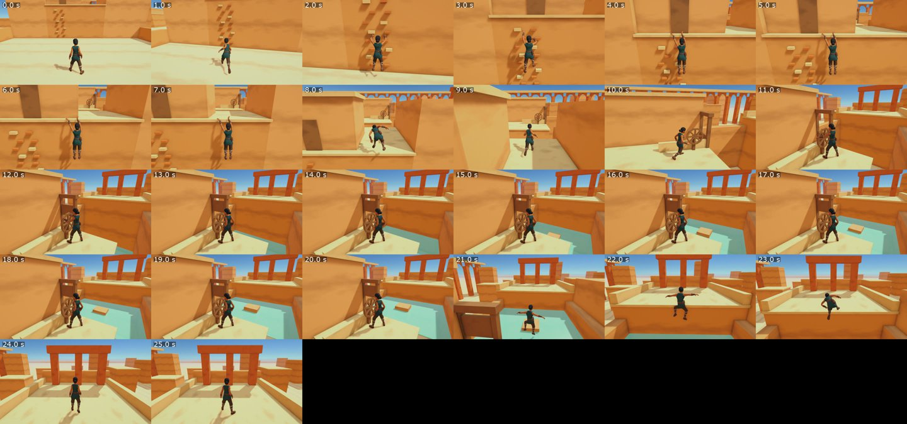

# Brimful

A young apprentice sluice-keeper climbs a sun-baked city whose aqueducts have run dry, opening the sluices on the way up so the water follows and the city fills again.
A 3D platformer with climbing, ledges, parkour and light water puzzles, for the desktop, built in Unity.

It is built for [x-gaming#8](https://github.com/imDev2023/x-gaming/issues/8), made the way [Sumiro](https://github.com/imDev2023/x-gaming/blob/main/sources/2026-11-04-xikhar-sumiro.md) was, with our own world, hero and levels.
"Brimful" is a working title.

## Where it stands

- Done: the [concept video](concept/video.mp4) and its [contact sheet](concept/sheet.jpg), with the spec written from its frames, including everything it got wrong: [SPEC.md](SPEC.md).
- Done: four [mood stills](concept/mood-sheet.jpg) from the gameplay camera, two stylised and two painted, judged in SPEC.md.
- Done: the hero became a human apprentice sluice-keeper at the owner's request; from four [hero stills](concept/human-sheet.jpg) the owner chose the young woman (woman-1).
- Done: the Unity project (Unity 6.6, URP), trimmed of the template's analytics, purchasing and other packages a desktop platformer does not use.
- Done: the hero's [sheet](concept/hero-sheets.jpg), cut into [three views](concept/hero-views.jpg) that agree, lifted to 3D with Tripo, cut to 49,864 triangles, rigged with Mixamo bone names and imported into Unity as a Humanoid, with Quaternius's CC0 clips retargeted onto her (SPEC.md, "The hero in 3D").
- Done: a playable prototype of one stretch, built in code: climb a wall of holds, hang from the lip and shimmy along it, pull up, jump a gap, turn a sluice's wheel and ride the rising water's crate up to a high arcade (SPEC.md, "The prototype stretch").
  
  A 25-second run: [samples/stretch-run.mp4](samples/stretch-run.mp4).
- Next: the owner's verdict on the stretch, then concept art per chapter and the look pass.
- Generation spent so far: 3.22 USD of the 10 USD planned up to the prototype.

## How it is built

- **Engine:** Unity 6.6 with the Universal Render Pipeline, desktop builds; the Unity project is this folder.
- **Method:** a generated video sets the look; only the hero objects are generated, from 4 views each, and baked down; walls, arches and channels are built in code with CC0 textures; CC0 models dress the rest.
  The pipeline is x-gaming's [WORKFLOW.md](https://github.com/imDev2023/x-gaming/blob/main/WORKFLOW.md).
- **Generation:** `node tools/fal.ts <name> <endpoint> <arguments.json>` runs one paid fal call and logs it in [fal-log.json](fal-log.json); `node tools/fal-usage.ts` reads its exact charge; `node tools/fal-upload.ts <file>` uploads a reference image (free).
- **Models:** `python3 -I tools/cut_views.py` cuts a 4-view sheet into the views Tripo reads; `tools/simplify.sh` cuts a Tripo model to budget; `tools/turntable.py` renders a model from eight sides and its head up close in headless Blender; `tools/rig_unity.py` rigs it with Mixamo bone names and exports the FBX and textures Unity reads (usage in each file's header).
- **Unity:** `Assets/Editor/BrimfulImport.cs` sets import options by folder, `Assets/Editor/HeroSetup.cs` builds the hero's material, clips, Animator controller and prefab, `Assets/Editor/HeroClips.cs` keys the hang and climb clips, `Assets/Editor/HeroCheck.cs` renders the hero in any set of poses, `Assets/Editor/StretchBuilder.cs` builds the prototype stretch, and `Assets/Editor/BuildPlayer.cs` builds the desktop player.
- **Testing:** `tools/playtest.sh` plays the stretch end to end with a scripted pilot in the Editor and records it; `tools/frames-to-mp4.sh` joins recorded frames into a clip and contact sheet; a built player started with `-batchmode -nographics -pilot` plays the stretch headless and exits 0 when it reaches the goal.

## Play it

Open the project in Unity 6.6, open `Assets/Scenes/Stretch.unity` and press Play, or build the Mac player with `Brimful.EditorTools.BuildPlayer.Mac()` and open `Builds/Mac/Brimful.app`.
WASD to move, the mouse to look (click to capture it, Esc to let go), Space to jump, Shift to sprint, E to turn the wheel; push into the holds to climb, A and D move along a ledge, W pulls up and S lets go.
  Every asset's source and terms are in [CREDITS.md](CREDITS.md).

## Licence

Use it however you want: copy it, change it, sell it or build your own game from it, with no credit required.

- **Code:** MIT No Attribution, in [LICENSE](LICENSE).
- **Our images, video and other assets:** dedicated to the public domain under CC0 1.0, in [LICENSE-ASSETS](LICENSE-ASSETS).
- Generated assets may also carry their generator's output terms; see [CREDITS.md](CREDITS.md).
